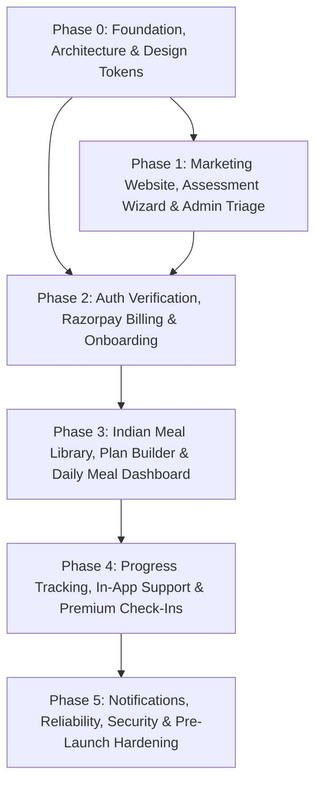

# Fitvora — Atomic Phase-Based Implementation Tasks

**Document Version:** 1.0  
**PRD Reference:** [Fitvora_PRD.md](file:///d:/Fitvora/Fitvora_PRD.md)  
**Status:** Build-Ready Engineering Specification  
**Architecture:** Next.js (App Router), TypeScript (Strict), Tailwind CSS, shadcn/ui, Supabase (PostgreSQL, Auth, RLS, Storage), Razorpay (Subscriptions), Resend (Transactional Email).

---

## 1. Execution Principles & Rules

1. **Strict Phased Delivery**: Work strictly through the phases in sequential order (`Phase 0` → `Phase 5`). Do not build downstream features before their dependencies exit cleanly.
2. **Phase Exit Criteria (Quality Gates)**: Every phase must pass:
   - Full TypeScript check (`tsc --noEmit`) with zero errors.
   - ESLint and Prettier validation without warnings.
   - Database migrations applied cleanly with complete Row-Level Security (RLS) policies.
   - Unit and integration tests passing for the current phase scope.
   - Verification against PRD Section 13 acceptance scenarios.
3. **Truthful Zero-Member States**: Production launches with zero members. All dashboards and lists must implement clean empty states ("No assessments pending", "No active members yet") instead of mock KPI figures or fake reviews.
4. **Safety & Data Minimization**: Health data must never be serialized in URLs, unencrypted localStorage, or analytics events. Normal (₹499) and Premium (₹999) get the exact same diet planning quality; Premium unlocks priority support and weekly check-ins only.
5. **Brand Consistency**: Maintain the approved visual identity: Forest Green (`#075B2B`), Fresh Green (`#2FAF37`), Pale Green (`#EAF8E7`), Warm Cream (`#FFFDF7`), White (`#FFFFFF`). Use the consistent female Indian wellness ambassador image assets stored in `Assests/`.

---

## 2. Phase Dependency Overview



---

## 3. Detailed Phase-Based Task Breakdown

```
Legend:
[P0] = MVP Mandatory Launch Blocker
[P1] = Fast-Follow / MVP Polish
[P2] = Post-Launch Future Scale
```

---

### Phase 0: Project Setup, Architecture Foundation & Design System (P0)

> **Objective:** Establish an enterprise-grade TypeScript/Next.js workspace with strict typing, shadcn/ui component library, Fitvora brand tokens, Supabase database client, environment validation, base schemas, and truthful empty states.  
> **Prerequisites:** Git repository initialized in `D:\Fitvora`.  
> **Phase Exit Criteria:** Clean build (`next build`), zero TypeScript errors, Supabase connection verified, design system preview route renders brand palette.

- [x] **TASK-0.1: Next.js App Router & Tooling Initialization** `[P0]`
  - **Module:** Infrastructure & DevEx
  - **Dependencies:** None
  - **Target Files:**
    - `package.json`
    - `tsconfig.json`
    - `.eslintrc.json`
    - `.prettierrc`
    - `.env.example`
    - `next.config.ts`
  - **Description:** Initialize Next.js 14+ with App Router, TypeScript in strict mode, ESLint, Prettier, PostCSS, and environment variable schema validation.
  - **Atomic Subtasks:**
    - [x] Initialize Next.js with `pnpm create next-app@latest . --typescript --tailwind --eslint --app --src-dir=false --import-alias="@/*"`.
    - [x] Configure `tsconfig.json` with strict null checks, no unchecked indexed access, and path aliases `@/*`.
    - [x] Set up `@t3-oss/env-nextjs` and `zod` for strictly typed environment variables (`NEXT_PUBLIC_SUPABASE_URL`, `NEXT_PUBLIC_SUPABASE_ANON_KEY`, `SUPABASE_SERVICE_ROLE_KEY`, `RAZORPAY_KEY_ID`, `RAZORPAY_KEY_SECRET`, `RESEND_API_KEY`, etc.).
    - [x] Configure `.env.example` documenting all required secrets with placeholder values.
  - **Acceptance Criteria:** `pnpm build` compiles cleanly without errors; missing required `.env` variables fail fast at build/boot time.

- [x] **TASK-0.2: Fitvora Design System & Brand Token Integration** `[P0]`
  - **Module:** UI & Design Tokens
  - **Dependencies:** `TASK-0.1`
  - **Target Files:**
    - `tailwind.config.ts`
    - `app/globals.css`
    - `components/ui/*`
    - `lib/utils.ts`
  - **Description:** Implement the Fitvora color palette, typography (Inter / Plus Jakarta Sans), border radii, elevation shadows, and install initial shadcn/ui primitives.
  - **Atomic Subtasks:**
    - [x] Define custom Tailwind color variables:
      - `forest-green`: `#075B2B`
      - `fresh-green`: `#2FAF37`
      - `pale-green`: `#EAF8E7`
      - `warm-cream`: `#FFFDF7`
      - Dark accessible text: `#1A2E1C` and neutral accents.
    - [x] Add font stack configuration in `app/globals.css` with fallbacks.
    - [x] Install and configure `clsx`, `tailwind-merge`, and initial UI primitives (`Button`, `Card`, `Badge`, `Skeleton`).
    - [x] Configure `prefers-reduced-motion` safety wrappers for all CSS and transitions.
  - **Acceptance Criteria:** A test component renders cards, buttons, and text using the official brand colors with WCAG 2.2 AA compliant contrast ratio (>4.5:1 for normal text).

- [x] **TASK-0.3: Ambassador Brand Asset Pipeline** `[P0]`
  - **Module:** Assets & Media
  - **Dependencies:** `TASK-0.1`
  - **Target Files:**
    - `public/images/character/*`
    - `components/ui/brand-character.tsx`
  - **Description:** Ingest, optimize, and organize the consistent female Indian wellness ambassador image assets from `Assests/` into public WebP/AVIF formats with accessible descriptive metadata.
  - **Atomic Subtasks:**
    - [x] Create directory `public/images/character/` and copy/convert relevant images from `Assests/`:
      - Hero portrait: `Warm Wellness Portrait.png` -> `hero-ambassador.png`
      - Healthy Eating: `Healthy Eating Explained at Home.png` -> `nutrition-guide.png`
      - Thali Wellness: `Smiling Woman with Indian Thali Meal.png` -> `thali-wellness.png`
      - Weight Gain Spread: `Healthy Weight Gain Fitness Spread.png` -> `weight-gain.png`
      - Weight Loss Spread: `Healthy Weight Loss Wellness Illustration.png` -> `weight-loss.png`
      - Coach with Clipboard: `Wellness Coach with Clipboard and Greenery.png` -> `coach-review.png`
      - Celebratory Pose: `Celebratory Fitness Progress Pose.png` -> `celebration.png`
    - [x] Create a reusable component `<BrandCharacter variant="..." />` that enforces Next.js `<Image>` optimizations, responsive `sizes`, explicit `width`/`height` (preventing Cumulative Layout Shift), and consistent alt text.
  - **Acceptance Criteria:** Images load lazily below the fold, preserve high fidelity on mobile/desktop, and maintain consistent visual character identity across pages.

- [x] **TASK-0.4: Supabase Client Architecture & RLS Middleware** `[P0]`
  - **Module:** Database & Backend
  - **Dependencies:** `TASK-0.1`
  - **Target Files:**
    - `lib/db/supabase-browser.ts`
    - `lib/db/supabase-server.ts`
    - `lib/db/supabase-admin.ts`
    - `middleware.ts`
  - **Description:** Configure `@supabase/ssr` with separate browser, server action, and privileged administrative clients using secure HTTP-only cookies and role verification.
  - **Atomic Subtasks:**
    - [x] Install `@supabase/ssr` and `@supabase/supabase-js`.
    - [x] Implement `createBrowserClient` for interactive client components.
    - [x] Implement `createServerClient` reading and writing cookies for Next.js Server Components and Server Actions.
    - [x] Implement `createAdminClient` utilizing `SUPABASE_SERVICE_ROLE_KEY` restricted strictly to server-only webhook handlers and background jobs.
    - [x] Configure `middleware.ts` to refresh Supabase auth sessions, guard `/dashboard/*` routes for authenticated members, and guard `/admin/*` routes for users with role `admin`.
  - **Acceptance Criteria:** Unauthenticated visits to `/dashboard` redirect to `/login`; non-admin access to `/admin` returns HTTP 403 or redirects to `/dashboard`. Service role key is never exported to client bundles.

- [x] **TASK-0.5: Base Database Schema & Migration Foundation** `[P0]`
  - **Module:** Database Schema
  - **Dependencies:** `TASK-0.4`
  - **Target Files:**
    - `supabase/migrations/20261121000001_core_schema.sql`
    - `types/database.types.ts`
  - **Description:** Implement core database tables (`profiles`, `memberships`, `audit_logs`, `consent_records`) with primary keys, foreign keys, timestamps, indexes, and initial RLS policies.
  - **Atomic Subtasks:**
    - [x] Write SQL migration defining:
      - `profiles`: `id` (references `auth.users`), `first_name`, `last_name`, `email`, `phone`, `timezone` (default 'Asia/Kolkata'), `role` (`visitor`, `member`, `admin`), `created_at`, `updated_at`.
      - `memberships`: `id` (uuid), `user_id` (references `profiles.id`), `lifecycle_status` (`invited`, `registered`, `active`, `paused`, `inactive`), `joined_at`, `updated_at`.
      - `consent_records`: `id` (uuid), `user_id` (nullable references `profiles.id`), `assessment_id` (uuid, nullable), `purpose` (text), `policy_version` (text), `ip_hash` (text), `granted_at` (timestamptz), `revoked_at` (timestamptz).
      - `audit_logs`: `id` (uuid), `actor_id` (references `profiles.id`), `action` (text), `entity_type` (text), `entity_id` (uuid), `metadata` (jsonb redacted), `created_at` (timestamptz).
    - [x] Enable Row Level Security (RLS) on all tables: users can only `SELECT` and `UPDATE` their own profile; admins can `SELECT` all; service role has full access.
    - [x] Generate TypeScript database definitions using Supabase CLI or create strictly typed mirrors in `types/database.types.ts`.
  - **Acceptance Criteria:** SQL migration runs idempotently against local or remote Supabase instance without errors; RLS blocks cross-user profile queries.

- [x] **TASK-0.6: Shared UI Component Suite & Truthful Empty States** `[P0]`
  - **Module:** UI Components
  - **Dependencies:** `TASK-0.2`
  - **Target Files:**
    - `components/ui/empty-state.tsx`
    - `components/ui/status-badge.tsx`
    - `components/ui/page-header.tsx`
    - `components/ui/loading-skeleton.tsx`
    - `components/marketing/navbar.tsx`
    - `components/marketing/footer.tsx`
  - **Description:** Build reusable UI components for state feedback, navigation headers, footers, and truthful zero-data empty states across member and admin portals.
  - **Atomic Subtasks:**
    - [x] Create `<EmptyState icon={...} title={...} description={...} action={...} />` component for zero-data views (zero members, zero assessments, zero messages).
    - [x] Build `<StatusBadge status={...} />` supporting states: `pending_review`, `approved`, `needs_info`, `not_suitable`, `active`, `expired`, `draft`, `published`.
    - [x] Build responsive `<Navbar />` and `<Footer />` featuring Fitvora logo, navigation links, tier pricing trigger, and primary CTA "Start My Journey".
  - **Acceptance Criteria:** Components render accurately on mobile (320px) up to 4K displays; empty states display informative next actions rather than blank screens or mock placeholders.

---

### Phase 1: Public Marketing Website, Assessment Wizard & Admin Triage (P0)

> **Objective:** Deliver the customer acquisition funnel: public landing pages, responsive Indian home-food assessment wizard (no signup required), secure assessment submission with opaque status token, and founder admin triage inbox for safety review.  
> **Prerequisites:** Phase 0 complete.  
> **Phase Exit Criteria:** Anonymous user completes assessment on mobile, receives confirmation; admin views assessment in `/admin/assessments`, flags health risks, and marks decision. Zero health details exposed in URLs or client storage.

- [x] **TASK-1.1: Public Landing Page (`/`)** `[P0]`
  - **Module:** Marketing
  - **Dependencies:** `TASK-0.2`, `TASK-0.3`, `TASK-0.6`
  - **Target Files:**
    - `app/(marketing)/page.tsx`
    - `components/marketing/hero-section.tsx`
    - `components/marketing/pathways-section.tsx`
    - `components/marketing/how-it-works-preview.tsx`
    - `components/marketing/meal-sample-preview.tsx`
    - `components/marketing/pricing-preview.tsx`
    - `components/marketing/faq-accordion.tsx`
  - **Description:** Build the Fitvora homepage with clear value proposition (no crash diets, no synthetic supplements, real Indian home food), dual pathways (Lose Weight / Gain Weight), illustrative Indian meal cards (labeled as examples, no fake claims), and primary CTA.
  - **Atomic Subtasks:**
    - [x] Build Hero Section with the brand ambassador, clear headline ("Sustainable Weight Management with Indian Home Food"), subheadline, and primary "Start My Journey" CTA directing to `/assessment`.
    - [x] Build Weight Loss vs. Weight Gain pathway cards highlighting tailored calorie balance with familiar home meals (dal, roti, sabzi, curd-rice, poha).
    - [x] Build "How It Works" 3-step teaser (Complete Assessment → Founder Review → Get Tailored Weekly Plan).
    - [x] Build Sample Indian Meals carousel showing realistic thalis, macro breakdowns labeled as "Representative Example", with no fabricated member before/after claims.
    - [x] Build Plan Comparison teaser (Normal ₹499/mo vs Premium ₹999/mo) with clear disclaimer: "Both tiers receive the same high standard of customized diet planning".
    - [x] Implement FAQ accordion addressing key questions (medical boundary, meal variety, vegetarians/eggetarians/non-veg).
  - **Acceptance Criteria:** Mobile Lighthouse Performance score ≥ 85; zero horizontal scroll at 320px width; "Start My Journey" CTA reachable within 2 taps.

- [x] **TASK-1.2: Specialized Informational & Legal Policy Pages** `[P0]`
  - **Module:** Marketing & Compliance
  - **Dependencies:** `TASK-1.1`
  - **Target Files:**
    - `app/(marketing)/how-it-works/page.tsx`
    - `app/(marketing)/weight-loss/page.tsx`
    - `app/(marketing)/weight-gain/page.tsx`
    - `app/(marketing)/plans/page.tsx`
    - `app/(legal)/privacy/page.tsx`
    - `app/(legal)/terms/page.tsx`
    - `app/(legal)/refund-policy/page.tsx`
    - `app/(legal)/contact/page.tsx`
  - **Description:** Build detailed content pages for weight-loss/gain methodologies, plans breakdown, and DPDP-compliant legal/privacy/refund policies.
  - **Atomic Subtasks:**
    - [x] Build `/how-it-works`: explain the end-to-end journey from intake assessment to personalized meal schedules and check-ins.
    - [x] Build `/weight-loss` and `/weight-gain` dedicated landing routes using shared structured template with nutritional rationale.
    - [x] Build `/plans`: comprehensive tier feature matrix (Normal ₹499 vs Premium ₹999), explicit renewal terms, and GST clarity.
    - [x] Build `/privacy`: DPDP Act aligned privacy policy specifying purpose of health data processing, data retention, deletion requests, and grievance officer contact.
    - [x] Build `/terms` and `/refund-policy`: clear medical non-diagnosis disclaimer, subscription cancellation rules, and refund conditions.
    - [x] Build `/contact`: verified business contact information and support email.
  - **Acceptance Criteria:** All legal routes return HTTP 200, contain clear readable terms, and feature prominent medical safety disclaimers.

- [x] **TASK-1.3: Assessment Database Schema & Migration** `[P0]`
  - **Module:** Database Schema
  - **Dependencies:** `TASK-0.5`
  - **Target Files:**
    - `supabase/migrations/20261121000002_assessment_schema.sql`
  - **Description:** Create relational schema for anonymous assessments, draft access tokens, health screening flags, and admin reviews.
  - **Atomic Subtasks:**
    - [x] Create `assessments` table:
      - `id`: uuid primary key default `gen_random_uuid()`.
      - `user_id`: uuid nullable references `profiles(id)`.
      - `draft_token_hash`: text unique not null (hashed opaque token for checking status).
      - `first_name`: text not null.
      - `email`: text not null.
      - `phone`: text.
      - `age`: integer not null check (`age >= 18`).
      - `gender`: text.
      - `height_cm`: numeric(5,2) not null check (`height_cm between 100 and 250`).
      - `weight_kg`: numeric(5,2) not null check (`weight_kg between 30 and 300`).
      - `target_direction`: text not null check (`target_direction in ('lose_weight', 'gain_weight', 'maintain_health')`).
      - `target_weight_kg`: numeric(5,2).
      - `timeline_weeks`: integer.
      - `routine_data`: jsonb not null (wake_time, sleep_time, work_shift, meal_timings, activity_level).
      - `food_preferences`: jsonb not null (diet_type: veg/egg/non-veg, allergies: text[], dislikes: text[], regional: text, budget: text, cooking_access: text).
      - `health_screening`: jsonb not null (conditions: text[], is_pregnant_or_nursing: boolean, medications: text, eating_disorder_history: boolean).
      - `consent_version`: text not null.
      - `health_consent_granted`: boolean not null check (`health_consent_granted = true`).
      - `status`: text not null default `'pending_review'` check (`status in ('pending_review', 'approved', 'needs_info', 'not_suitable')`).
      - `submitted_at`: timestamptz not null default `now()`.
    - [x] Create `assessment_reviews` table:
      - `id`: uuid primary key,
      - `assessment_id`: uuid not null references `assessments(id)` on delete cascade,
      - `reviewer_id`: uuid not null references `profiles(id)`,
      - `decision`: text not null check (`decision in ('approved', 'needs_info', 'not_suitable')`),
      - `safety_flags`: text[] default '{}',
      - `reviewer_notes`: text,
      - `reviewed_at`: timestamptz not null default `now()`.
    - [x] Configure RLS: anonymous visitors cannot `SELECT` public assessments; assessments can only be queried via secure RPC with `draft_token_hash` or by users with role `admin`.
  - **Acceptance Criteria:** Migration runs cleanly; unauthenticated `SELECT * FROM assessments` returns 0 rows via RLS.

- [x] **TASK-1.4: Multi-Step Assessment Wizard State & Zod Schemas** `[P0]`
  - **Module:** Assessment Frontend & Validation
  - **Dependencies:** `TASK-1.3`
  - **Target Files:**
    - `lib/validation/assessment-schema.ts`
    - `features/assessments/assessment-store.ts`
  - **Description:** Implement strict client/server Zod validation schemas for all 6 steps of the assessment wizard, preventing invalid submissions or minors from proceeding.
  - **Atomic Subtasks:**
    - [x] Step 1 Schema (`aboutYouSchema`): First name (min 2 chars), email (valid format), optional phone (10-digit Indian regex), age (18 to 99), optional gender.
    - [x] Step 2 Schema (`bodyGoalSchema`): Height cm (100–250), weight kg (30–300), target direction (`lose_weight`, `gain_weight`), realistic target timeline.
    - [x] Step 3 Schema (`routineSchema`): Wake/sleep times, shift type (day/overnight), meal frequencies (2, 3, 4, 5+ meals), activity level (sedentary, lightly active, active, very active).
    - [x] Step 4 Schema (`preferencesSchema`): Diet type (`vegetarian`, `eggetarian`, `non_vegetarian`), allergen array, regional preference (North, South, East, West, Central, Pan-Indian), cooking facilities.
    - [x] Step 5 Schema (`wellnessSchema`): Medical conditions selection, pregnancy/lactation checkbox, medications impacting digestion, eating disorder history checkbox.
    - [x] Step 6 Schema (`consentSchema`): Explicit health data processing consent checkbox (mandatory) and optional marketing consent.
    - [x] Implement client-side form state management with validated steps; never save raw sensitive health screening in plain `localStorage`.
  - **Acceptance Criteria:** Minors under 18 receive an immediate friendly message that Fitvora is currently only designed for adults 18+; schema validates correctly on both client and server.

- [x] **TASK-1.5: Assessment Submission API & Opaque Status Token** `[P0]`
  - **Module:** Assessment API
  - **Dependencies:** `TASK-1.3`, `TASK-1.4`
  - **Target Files:**
    - `app/api/assessments/route.ts`
    - `app/api/assessments/[token]/status/route.ts`
    - `lib/utils/crypto.ts`
  - **Description:** Implement server route handler for assessment submission with IP rate limiting, input sanitization, opaque token generation, and secure status retrieval.
  - **Atomic Subtasks:**
    - [x] Implement `POST /api/assessments`:
      - Verify payload against master `assessmentSubmissionSchema`.
      - Check automated safety flags (minors, pregnancy, eating disorders, conditions, extreme BMI).
      - Generate a high-entropy random opaque token (32 bytes hex) and its SHA-256 hash.
      - Save record into `assessments` with status `pending_review` and `draft_token_hash`.
      - Record consent in `consent_records`.
      - Return `{ success: true, token: opaqueToken }` without exposing sensitive answers in response.
    - [x] Implement `GET /api/assessments/[token]/status`:
      - Hash incoming token with SHA-256, query `assessments` matching `draft_token_hash`.
      - Return only non-sensitive metadata: `{ status: 'pending_review' | 'approved' | 'needs_info' | 'not_suitable', submitted_at: string, first_name: string }`.
  - **Acceptance Criteria:** API returns HTTP 201 on valid submission; status route reveals status without exposing phone, health conditions, or sensitive screening data.

- [x] **TASK-1.6: Assessment Wizard User Interface & Mobile Flow** `[P0]`
  - **Module:** Assessment Frontend
  - **Dependencies:** `TASK-1.4`, `TASK-1.5`
  - **Target Files:**
    - `app/assessment/page.tsx`
    - `app/assessment/complete/page.tsx`
    - `components/assessment/step-indicator.tsx`
    - `components/assessment/step-about.tsx`
    - `components/assessment/step-body.tsx`
    - `components/assessment/step-routine.tsx`
    - `components/assessment/step-preferences.tsx`
    - `components/assessment/step-wellness.tsx`
    - `components/assessment/step-review.tsx`
  - **Description:** Build the responsive 6-step assessment wizard with step indicators, accessible form controls, input masks, and completion confirmation screen.
  - **Atomic Subtasks:**
    - [x] Build `<StepIndicator currentStep={...} totalSteps={6} />` with animated progress bar and clear step labels.
    - [x] Build Step 1 through Step 5 components with 44px touch targets, mobile numeric keyboards (`inputMode="decimal"` for height/weight), and clear error messages.
    - [x] Build Step 6 Review & Consent: summary card of user answers with inline "Edit" jump links, mandatory privacy consent checkbox, and submit CTA with loading spinner.
    - [x] Build `/assessment/complete`: confirmation page explaining the founder manual review process (12–24h), next steps, and instruction to check email for invitation upon approval.
  - **Acceptance Criteria:** Full wizard navigable via keyboard; back button preserves previously filled answers; completion screen renders without sensitive query parameters.

- [x] **TASK-1.7: Admin Assessment Triage Portal** `[P0]`
  - **Module:** Admin Operations
  - **Dependencies:** `TASK-1.3`, `TASK-1.5`
  - **Target Files:**
    - `app/admin/assessments/page.tsx`
    - `app/admin/assessments/[id]/page.tsx`
    - `components/admin/assessment-card.tsx`
    - `components/admin/review-modal.tsx`
    - `app/api/admin/assessments/[id]/review/route.ts`
  - **Description:** Build the founder admin portal to inspect submitted assessments, flag health risks, add internal notes, and make review decisions (`approved`, `needs_info`, `not_suitable`).
  - **Atomic Subtasks:**
    - [x] Build `/admin/assessments` listing all submissions with filter tabs: `Pending Review`, `Approved`, `Needs Info`, `Not Suitable`.
    - [x] Implement automated visual safety tags in triage view (e.g. `⚠️ Minor (Under 18)`, `⚠️ Pregnancy/Lactation`, `⚠️ Heart/Kidney/Diabetes`, `⚠️ Eating Disorder Concern`, `⚠️ Extreme BMI`).
    - [x] Build assessment detail view displaying routine, Indian food preferences, portion habits, and screening details.
    - [x] Build Decision Action panel with inputs:
      - Decision: radio selection (`approved`, `needs_info`, `not_suitable`).
      - Internal Notes: textarea for founder notes.
    - [x] Create `POST /api/admin/assessments/[id]/review` endpoint to persist review in `assessment_reviews`, update `assessments.status`, and write to `audit_logs`.
  - **Acceptance Criteria:** Admin can review an assessment and change its status; audit log captures reviewer ID and timestamp; unauthorized non-admin requests return HTTP 403.

- [x] **TASK-1.8: Founder Email Notification for New Assessments** `[P0]`
  - **Module:** Notifications
  - **Dependencies:** `TASK-1.5`
  - **Target Files:**
    - `lib/email/resend-client.ts`
    - `lib/email/templates/new-assessment-alert.tsx`
  - **Description:** Send a transactional email notification to the founder upon new assessment submission without sensitive health details in subject or plain text preview.
  - **Atomic Subtasks:**
    - [x] Configure Resend SDK in `lib/email/resend-client.ts`.
    - [x] Design email notification: "New Fitvora Assessment Received: [First Name] - [Goal: Lose/Gain]".
    - [x] Include secure deep link to `/admin/assessments/[id]` to review directly.
    - [x] Trigger alert asynchronously in submission handler; gracefully log and continue if email sending fails.
  - **Acceptance Criteria:** Submitting an assessment triggers an email to `ADMIN_NOTIFICATION_EMAIL` within 5 seconds; subject line contains zero medical data.

---

### Phase 2: Authentication Lifecycle, Razorpay Subscriptions & Member Onboarding (P0)

> **Objective:** Convert approved assessment leads into registered members, handle payment checkout for Normal (₹499) and Premium (₹999) subscriptions, process webhook lifecycle events with strict idempotency, and provide self-service subscription management.  
> **Prerequisites:** Phase 0 and Phase 1 completed.  
> **Phase Exit Criteria:** Approved lead claims assessment via invitation, completes sandbox payment for both ₹499 and ₹999 plans; failed payments deny access; duplicate webhooks do not duplicate entitlements; active membership unlocks `/dashboard`.

- [ ] **TASK-2.1: Member Auth Skeleton & Assessment Account Claiming** `[P0]`
  - **Module:** Authentication & Onboarding
  - **Dependencies:** `TASK-0.4`, `TASK-1.7`
  - **Target Files:**
    - `app/(auth)/login/page.tsx`
    - `app/(auth)/signup/page.tsx`
    - `app/(auth)/claim/page.tsx`
    - `app/(auth)/reset-password/page.tsx`
    - `features/auth/claim-action.ts`
  - **Description:** Implement email/password and magic-link authentication with email verification, along with an invitation-based account claim flow that securely links an approved assessment to a newly created member profile.
  - **Atomic Subtasks:**
    - [ ] Implement Supabase Auth `/login`, `/signup`, `/reset-password` pages matching the Fitvora brand palette.
    - [ ] Create `/claim?token=...` route:
      - Validates token hash against `assessments` where `status = 'approved'` and `user_id IS NULL`.
      - Prefills email and first name; prompts user to set a secure password.
      - On successful auth signup, links `assessments.user_id = auth.uid()` and creates `memberships` entry with status `invited`.
    - [ ] Enforce email verification before allowing access to billing checkout.
  - **Acceptance Criteria:** User cannot claim an unapproved or already-claimed assessment; verified signup correctly associates the assessment ID with the new user profile.

- [ ] **TASK-2.2: Plans Catalog & Subscription Schema Migration** `[P0]`
  - **Module:** Database Schema
  - **Dependencies:** `TASK-0.5`
  - **Target Files:**
    - `supabase/migrations/20261121000003_subscriptions_schema.sql`
  - **Description:** Implement database tables for subscription tiers, active subscriptions, and idempotent payment event logging.
  - **Atomic Subtasks:**
    - [ ] Create `plans_catalog` table:
      - `id`: text primary key (`normal`, `premium`).
      - `name`: text not null ('Normal Plan', 'Premium Plan').
      - `price_paise`: integer not null (49900 for ₹499, 99900 for ₹999).
      - `currency`: text not null default 'INR'.
      - `billing_interval`: text not null default 'month'.
      - `features`: jsonb not null.
      - `is_active`: boolean not null default true.
    - [ ] Create `subscriptions` table:
      - `id`: uuid primary key default `gen_random_uuid()`.
      - `user_id`: uuid not null references `profiles(id)`.
      - `plan_id`: text not null references `plans_catalog(id)`.
      - `provider_customer_id`: text.
      - `provider_subscription_id`: text unique.
      - `status`: text not null check (`status in ('created', 'authenticated', 'active', 'pending', 'halted', 'cancelled', 'completed', 'expired')`).
      - `current_period_start`: timestamptz.
      - `current_period_end`: timestamptz.
      - `cancel_at_period_end`: boolean default false.
      - `created_at`: timestamptz not null default `now()`.
      - `updated_at`: timestamptz not null default `now()`.
    - [ ] Create `payment_events` table:
      - `id`: uuid primary key default `gen_random_uuid()`.
      - `provider_event_id`: text not null unique,
      - `event_type`: text not null,
      - `signature_verified`: boolean not null default false,
      - `processed_status`: text not null check (`processed_status in ('processed', 'ignored', 'failed')`),
      - `payload`: jsonb not null,
      - `created_at`: timestamptz not null default `now()`.
    - [ ] Apply RLS: Members can view only their own subscription records; payment events are restricted to service role.
  - **Acceptance Criteria:** Migration runs cleanly; `payment_events` enforces unique `provider_event_id` constraint preventing duplicate processing.

- [ ] **TASK-2.3: Razorpay Subscription Gateway Integration** `[P0]`
  - **Module:** Billing & Integrations
  - **Dependencies:** `TASK-2.2`
  - **Target Files:**
    - `lib/integrations/razorpay.ts`
    - `app/api/billing/checkout/route.ts`
    - `types/billing.types.ts`
  - **Description:** Configure Razorpay SDK to create recurring subscription orders, manage customer entities, and initiate hosted checkout.
  - **Atomic Subtasks:**
    - [ ] Install `razorpay` npm package and configure singleton in `lib/integrations/razorpay.ts` with strict error handling.
    - [ ] Implement `POST /api/billing/checkout`:
      - Verify user is authenticated and has an approved assessment.
      - Validate requested plan (`normal` vs `premium`).
      - Create or retrieve Razorpay customer record for `user_id`.
      - Create Razorpay subscription via API with `plan_id` (`normal` = ₹499/mo, `premium` = ₹999/mo).
      - Return `{ subscription_id: string, key_id: string, amount: number, currency: 'INR' }`.
  - **Acceptance Criteria:** Checkout API generates valid Razorpay subscription ID in sandbox mode; rejects unauthenticated or unapproved users.

- [ ] **TASK-2.4: Checkout Interface & Legal Billing Disclosures** `[P0]`
  - **Module:** Billing Frontend
  - **Dependencies:** `TASK-2.3`
  - **Target Files:**
    - `app/checkout/page.tsx`
    - `components/billing/checkout-card.tsx`
    - `components/billing/razorpay-button.tsx`
  - **Description:** Build the responsive checkout page with order summary, explicit recurring billing disclosures, refund policy consent checkbox, and Razorpay standard checkout popup.
  - **Atomic Subtasks:**
    - [ ] Build `/checkout` route reading selected plan from query parameters (`?plan=normal` or `?plan=premium`).
    - [ ] Display order breakdown: plan name, billing cycle (Monthly), gross amount in INR (₹499 or ₹999), and tax notice.
    - [ ] Add mandatory consent checkbox: "I understand this is a monthly recurring wellness subscription. I have read the Refund Policy and understand diets are individualized home food plans, not clinical cures."
    - [ ] Implement client-side Razorpay modal invocation script (`https://checkout.razorpay.com/v1/checkout.js`) with brand colors (`#075B2B`).
    - [ ] Handle Razorpay modal dismissal and payment error states gracefully with clear user guidance.
  - **Acceptance Criteria:** User cannot open payment modal without checking terms and refund consent; successful modal completion displays a processing loader while webhook confirms.

- [ ] **TASK-2.5: Razorpay Webhook Ingestion & Idempotent Event Engine** `[P0]`
  - **Module:** Billing Backend
  - **Dependencies:** `TASK-2.2`, `TASK-2.3`
  - **Target Files:**
    - `app/api/webhooks/payments/route.ts`
    - `features/billing/webhook-processor.ts`
  - **Description:** Build a hardened webhook handler that verifies HMAC-SHA256 signatures, deduplicates events using `payment_events`, and updates member subscription states.
  - **Atomic Subtasks:**
    - [ ] Implement `POST /api/webhooks/payments`:
      - Extract `x-razorpay-signature` and raw body text.
      - Validate signature against `RAZORPAY_WEBHOOK_SECRET` using crypto HMAC-SHA256. Return HTTP 400 if invalid.
      - Check `payment_events` table for `provider_event_id`. If already present, return HTTP 200 immediately (idempotency).
      - Insert raw sanitized payload into `payment_events`.
    - [ ] Implement event handler switch in `webhook-processor.ts`:
      - `subscription.authenticated` / `subscription.activated`: set `subscriptions.status = 'active'`, update `current_period_start`/`end`, set `memberships.lifecycle_status = 'active'`.
      - `subscription.charged`: update renewal period dates.
      - `subscription.halted` / `payment.failed`: set status to `halted`, send failure notification.
      - `subscription.cancelled`: set `cancel_at_period_end = true` or `status = 'cancelled'`.
  - **Acceptance Criteria:** Duplicate webhooks do not double-activate memberships; invalid signatures return HTTP 400; verified subscriptions transition member state to `active`.

- [ ] **TASK-2.6: Member Subscription & Billing Portal** `[P0]`
  - **Module:** Member Dashboard
  - **Dependencies:** `TASK-2.5`
  - **Target Files:**
    - `app/dashboard/subscription/page.tsx`
    - `components/billing/subscription-details-card.tsx`
    - `components/billing/cancel-dialog.tsx`
    - `features/billing/subscription-actions.ts`
  - **Description:** Provide members with a self-service billing page showing current tier (Normal/Premium), next renewal date, payment history, and cancellation controls.
  - **Atomic Subtasks:**
    - [ ] Display current subscription status card with tier badge, renewal date, and billing amount.
    - [ ] Provide "Cancel Subscription" button with modal confirmation explaining access remains active until the end of the current paid billing period.
    - [ ] Implement server action to call Razorpay cancel API (`cancel_at_cycle_end: true`) and update local `subscriptions` table.
    - [ ] Display link to refund policy and support contact for billing questions.
  - **Acceptance Criteria:** Member can view billing details and initiate cancellation; cancelled status updates immediately in UI reflecting active access until period end.

- [ ] **TASK-2.7: Admin Members & Subscriptions Management** `[P0]`
  - **Module:** Admin Operations
  - **Dependencies:** `TASK-2.5`
  - **Target Files:**
    - `app/admin/members/page.tsx`
    - `app/admin/members/[id]/page.tsx`
    - `app/admin/subscriptions/page.tsx`
    - `components/admin/member-table.tsx`
  - **Description:** Build administrative directories for the founder to search members, inspect subscription health, view payment status, and audit member lifecycles.
  - **Atomic Subtasks:**
    - [ ] Build `/admin/members`: searchable table showing Name, Email, Tier (Normal/Premium), Joined Date, Plan Status (Draft/Published/None), and Last Check-in.
    - [ ] Build `/admin/subscriptions`: overview of provider-synced subscriptions, billing failures, and renewal dates.
    - [ ] Member Detail view `/admin/members/[id]`: full history of assessment, active diet plan, weight entries, and subscription history.
    - [ ] Implement manual status override restricted strictly to admin with mandatory reason prompt written to `audit_logs`.
  - **Acceptance Criteria:** Admin can filter members by tier and status; search by name/email responds instantaneously; all admin modifications are logged to `audit_logs`.

---

### Phase 3: Indian Meal Library, Plan Builder Engine & Member Meal Dashboard (P0)

> **Objective:** Deliver the primary paid service: reusable Indian home-food meal templates, admin 7-day personalized diet plan builder with allergy safety checks, immutable versioning upon publication, and the member daily meal dashboard.  
> **Prerequisites:** Phase 2 completed.  
> **Phase Exit Criteria:** Founder builds and publishes a 7-day plan from Indian meal templates; member logs into `/dashboard` and views today's meals, portions, timing, and alternative swaps; unpublished drafts remain invisible to members.

- [ ] **TASK-3.1: Meal Library & Diet Plan Database Schema** `[P0]`
  - **Module:** Database Schema
  - **Dependencies:** `TASK-0.5`
  - **Target Files:**
    - `supabase/migrations/20261121000004_diet_plans_schema.sql`
  - **Description:** Create database tables for reusable Indian meal templates, weekly diet plans, scheduled meals, and immutable publication versioning.
  - **Atomic Subtasks:**
    - [ ] Create `meal_templates` table:
      - `id`: uuid primary key default `gen_random_uuid()`.
      - `title`: text not null (e.g. 'Vegetable Poha with Peanuts', 'Dal Tadka, 2 Phulkas & Bhindi Sabzi').
      - `meal_type`: text not null check (`meal_type in ('breakfast', 'morning_snack', 'lunch', 'evening_snack', 'dinner', 'post_dinner')`).
      - `diet_category`: text not null check (`diet_category in ('vegetarian', 'eggetarian', 'non_vegetarian')`).
      - `ingredients`: jsonb not null (array of { name, quantity, unit }).
      - `default_portion`: text not null (e.g., '1 medium bowl (200g)', '2 standard phulkas + 1 cup dal').
      - `preparation_notes`: text,
      - `regional_tags`: text[] default '{}' (e.g. ['north_indian', 'maharashtrian']),
      - `allergen_tags`: text[] default '{}' (e.g. ['peanuts', 'gluten', 'dairy', 'mustard']),
      - `approx_calories`: integer,
      - `approx_protein_g`: numeric(4,1),
      - `alternatives`: jsonb default '[]' (array of alternative suggestions),
      - `is_active`: boolean not null default true.
    - [ ] Create `diet_plans` table:
      - `id`: uuid primary key default `gen_random_uuid()`.
      - `user_id`: uuid not null references `profiles(id)`.
      - `version`: integer not null default 1,
      - `status`: text not null check (`status in ('draft', 'published', 'archived')`),
      - `effective_start_date`: date not null,
      - `effective_end_date`: date,
      - `guidance_notes`: text,
      - `created_by`: uuid not null references `profiles(id)`,
      - `published_at`: timestamptz,
      - `created_at`: timestamptz not null default `now()`.
    - [ ] Create `diet_plan_meals` table:
      - `id`: uuid primary key default `gen_random_uuid()`.
      - `diet_plan_id`: uuid not null references `diet_plans(id)` on delete cascade,
      - `day_of_week`: integer not null check (`day_of_week between 0 and 6`), -- 0=Sunday, 1=Monday...
      - `meal_type`: text not null,
      - `scheduled_time`: time not null, -- e.g. 08:30:00
      - `meal_template_id`: uuid references `meal_templates(id)`,
      - `custom_title`: text,
      - `custom_portion`: text not null,
      - `custom_notes`: text,
      - `custom_alternatives`: jsonb default '[]',
      - `order_index`: integer not null default 0.
    - [ ] Apply RLS: Members can `SELECT` only `diet_plans` where `user_id = auth.uid()` and `status = 'published'`; members cannot see `draft` or `archived` plans; admins have full access.
  - **Acceptance Criteria:** Migration runs cleanly; non-admin member querying draft diet plans receives 0 records via RLS.

- [ ] **TASK-3.2: Reusable Indian Home-Food Meal Library Seeding & Admin CRUD** `[P0]`
  - **Module:** Meal Library
  - **Dependencies:** `TASK-3.1`
  - **Target Files:**
    - `supabase/seed/meal_templates.sql`
    - `app/admin/meal-library/page.tsx`
    - `app/admin/meal-library/new/page.tsx`
    - `components/admin/meal-template-form.tsx`
    - `app/api/admin/meal-templates/route.ts`
  - **Description:** Seed the library with diverse, culturally familiar Indian home-cooked meals across regions and provide an admin CRUD interface for the founder.
  - **Atomic Subtasks:**
    - [ ] Seed standard Indian meal templates:
      - Breakfast: Vegetable Poha, Besan Chilla with Mint Chutney, Oats Upma, Idli Sambhar, Paneer Bhurji with Roti, Boiled Eggs with Toast.
      - Lunch: Dal Tadka with 2 Roti and Gobi Sabzi, Curd Rice with Tadka, Rajma Chawal with Kachumber Salad, Chicken Curry with Phulkas.
      - Evening Snacks: Roasted Chana, Sprouted Moong Chaat, Masala Buttermilk, Paneer Tikka cubes.
      - Dinner: Moong Dal Khichdi with Curd, Palak Paneer with Multigrain Roti, Lauki Sabzi with 2 Phulkas, Soya Chunk Pulao.
    - [ ] Build `/admin/meal-library` list view with search, filter by meal type (Breakfast/Lunch/Dinner), and dietary category.
    - [ ] Build Template Editor form with tag inputs for allergens and regional cuisine.
  - **Acceptance Criteria:** Meal library displays seeded templates; admin can create, update, or archive meal templates without errors.

- [ ] **TASK-3.3: 7-Day Diet Plan Builder Engine & Allergen Safety Warning** `[P0]`
  - **Module:** Diet Plan Builder
  - **Dependencies:** `TASK-3.1`, `TASK-3.2`
  - **Target Files:**
    - `app/admin/diet-plans/new/page.tsx`
    - `app/admin/diet-plans/[id]/edit/page.tsx`
    - `components/admin/plan-builder/day-column.tsx`
    - `components/admin/plan-builder/meal-picker-modal.tsx`
    - `components/admin/plan-builder/allergen-banner.tsx`
    - `features/diet-plans/plan-builder-store.ts`
  - **Description:** Build an intuitive 7-day visual plan builder for the founder to assemble custom plans from templates, customize portions, and validate allergen safety against member preferences.
  - **Atomic Subtasks:**
    - [ ] Build 7-day tabbed view (Monday through Sunday) with meal slots (Breakfast, Snack, Lunch, Snack, Dinner).
    - [ ] Implement Meal Template Picker modal allowing quick search and insertion into any meal slot.
    - [ ] Allow inline editing of serving portions (e.g. change "1 bowl" to "1.5 bowls" for weight gain), scheduled times, and custom instructions.
    - [ ] Implement Automated Allergen Warning Banner: cross-checks ingredients and tags in the plan against the member's disclosed allergies from their assessment. Display a prominent red warning if an allergen is detected.
    - [ ] Support night-shift schedules by associating meal slots with local order indices rather than strictly locking to AM/PM daylight assumptions.
  - **Acceptance Criteria:** Plan builder saves drafts to `diet_plans` and `diet_plan_meals`; allergen detection highlights any matched allergy tag immediately in the UI.

- [ ] **TASK-3.4: Plan Publication, Version Snapshotting & State Transitions** `[P0]`
  - **Module:** Diet Plan Engine
  - **Dependencies:** `TASK-3.3`
  - **Target Files:**
    - `app/api/admin/diet-plans/[id]/publish/route.ts`
    - `features/diet-plans/publish-plan-action.ts`
  - **Description:** Implement plan publication engine that verifies completeness, archives prior active plans, increments version counters, and publishes the immutable plan.
  - **Atomic Subtasks:**
    - [ ] Create `POST /api/admin/diet-plans/[id]/publish`:
      - Validate that all 7 days have at least primary meals (Breakfast, Lunch, Dinner).
      - Check that member has an active subscription.
      - In a single database transaction:
        - Set any existing `published` plans for this member to `archived`.
        - Set current plan status to `published`, record `published_at = now()`.
        - Increment plan version number.
      - Log action to `audit_logs`.
    - [ ] Provide preview mode allowing founder to inspect the exact view the member will see before clicking "Publish Plan".
  - **Acceptance Criteria:** Publishing creates an active plan; prior plans are safely archived; draft edits cannot corrupt currently published member plans.

- [ ] **TASK-3.5: Member Daily Meal Dashboard (`/dashboard`)** `[P0]`
  - **Module:** Member Dashboard
  - **Dependencies:** `TASK-3.1`, `TASK-3.4`
  - **Target Files:**
    - `app/dashboard/page.tsx`
    - `components/dashboard/greeting-banner.tsx`
    - `components/dashboard/meal-card.tsx`
    - `components/dashboard/alternative-swap-modal.tsx`
    - `components/dashboard/plan-pending-card.tsx`
  - **Description:** Build the primary member home dashboard displaying greeting, current goal, today's meal schedule with times, portion guidance, and alternative swaps.
  - **Atomic Subtasks:**
    - [ ] Implement dashboard state logic:
      - If no published plan exists yet: show `<PlanPendingCard />` ("Your founder-customized meal plan is being prepared. Typical turnaround is within 24 hours of payment.").
      - If subscription is expired: show renew callout.
      - If plan is active: render today's meal list.
    - [ ] Build `<MealCard />`: shows meal time (e.g. "8:30 AM"), meal type ("Breakfast"), food title, exact portion, preparation tip, and "View Alternative" button.
    - [ ] Build `<AlternativeSwapModal />`: allows members to view approved home-food alternatives (e.g. swap Poha for Vegetable Upma with equal calories/portion) without altering base plan integrity.
    - [ ] Highlight next upcoming meal based on member's current local device time.
  - **Acceptance Criteria:** Member sees today's meals organized chronologically; clicking alternative swaps reveals approved substitutions; zero broken layouts on mobile.

- [ ] **TASK-3.6: Member Weekly Meal Schedule Route (`/dashboard/meal-plan`)** `[P0]`
  - **Module:** Member Dashboard
  - **Dependencies:** `TASK-3.5`
  - **Target Files:**
    - `app/dashboard/meal-plan/page.tsx`
    - `components/dashboard/weekly-plan-tabs.tsx`
    - `components/dashboard/grocery-overview.tsx`
  - **Description:** Provide a full 7-day interactive view of the published weekly plan with day tabs, detailed ingredient breakdowns, and print/PDF-friendly layout.
  - **Atomic Subtasks:**
    - [ ] Build day navigation tabs (Monday to Sunday) with active state defaulting to the current day.
    - [ ] Render all daily meals in structured order with ingredients and portion sizes.
    - [ ] Add a clean "Print Plan" or "Save as PDF" styled view utilizing CSS print media queries (`@media print`).
    - [ ] Provide simple consolidated grocery overview of key staple ingredients (e.g. paneer, eggs, vegetables, dals) required for the week.
  - **Acceptance Criteria:** Member can browse all 7 days of the week; print stylesheet cleanly formats the week's diet plan on standard A4 paper without navigation headers or footers.

- [ ] **TASK-3.7: Member Profile & Dietary Preferences Management** `[P0]`
  - **Module:** Member Dashboard
  - **Dependencies:** `TASK-0.5`
  - **Target Files:**
    - `app/dashboard/profile/page.tsx`
    - `components/dashboard/profile-form.tsx`
    - `components/dashboard/preferences-view.tsx`
  - **Description:** Allow members to manage profile details (name, phone, timezone), view submitted intake preferences, and review privacy settings.
  - **Atomic Subtasks:**
    - [ ] Build profile editor for contact details and IANA timezone selection.
    - [ ] Build read-only view of recorded food preferences, allergies, and goal baseline from assessment.
    - [ ] Provide "Request Preference Update" CTA that routes to support messaging rather than letting users silently mutate allergies without founder review.
    - [ ] Include explicit Privacy & Data Rights section with "Request Data Export" and "Request Account Deletion" action buttons.
  - **Acceptance Criteria:** Updating profile saves to `profiles` table; allergy data remains protected and cannot be changed without review.

---

### Phase 4: Progress Tracking, In-App Support Inbox & Premium Check-Ins (P0/P1)

> **Objective:** Foster retention and fulfill tier promises: weight progress tracking with trend charts, member-to-admin support ticketing, priority queue differentiation for Premium (₹999), and structured weekly check-ins for Premium members.  
> **Prerequisites:** Phase 3 completed.  
> **Phase Exit Criteria:** Member logs weight entries, views interactive trend chart; Normal member submits standard support ticket; Premium member submits ticket flagged as priority; Premium member submits weekly check-in form and receives founder feedback.

- [ ] **TASK-4.1: Weight Tracking Database Schema & Server Actions** `[P0]`
  - **Module:** Progress Tracking
  - **Dependencies:** `TASK-0.5`
  - **Target Files:**
    - `supabase/migrations/20261121000005_progress_schema.sql`
    - `features/progress/weight-actions.ts`
    - `lib/validation/weight-schema.ts`
  - **Description:** Implement relational table for member weight entries with duplicate prevention, validation, and secure CRUD server actions.
  - **Atomic Subtasks:**
    - [ ] Create `weight_entries` table:
      - `id`: uuid primary key default `gen_random_uuid()`.
      - `user_id`: uuid not null references `profiles(id)` on delete cascade.
      - `weight_kg`: numeric(5,2) not null check (`weight_kg between 30 and 300`).
      - `recorded_at`: date not null default `current_date`.
      - `notes`: text,
      - `created_at`: timestamptz not null default `now()`.
      - Unique constraint on `(user_id, recorded_at)` to prevent accidental duplicate entries on the same day.
    - [ ] Configure RLS: Members can `SELECT`, `INSERT`, `UPDATE`, and `DELETE` only their own weight entries.
    - [ ] Implement Server Actions in `weight-actions.ts` with Zod validation:
      - `logWeightEntry(weightKg, date, notes)`
      - `deleteWeightEntry(id)`
      - `getWeightHistory(userId, days)`
  - **Acceptance Criteria:** Members cannot log invalid weights (<30kg or >300kg); duplicate entries on the same date prompt user to update instead of inserting.

- [ ] **TASK-4.2: Interactive Weight Trend Visualization (`/dashboard/progress`)** `[P0]`
  - **Module:** Progress Frontend
  - **Dependencies:** `TASK-4.1`
  - **Target Files:**
    - `app/dashboard/progress/page.tsx`
    - `components/progress/weight-chart.tsx`
    - `components/progress/weight-log-modal.tsx`
    - `components/progress/milestone-card.tsx`
  - **Description:** Build the member progress tracking page featuring interactive Recharts trend visualization, date range filters (7/30/90 days/All), baseline comparison, and compassionate milestone cards.
  - **Atomic Subtasks:**
    - [ ] Install `recharts` and build responsive `<WeightChart data={...} />`:
      - X-axis formatted with localized dates; Y-axis automatically zoomed around member range.
      - Smooth line/area chart using Fitvora Fresh Green (`#2FAF37`).
      - Reference line showing initial baseline weight.
    - [ ] Add range selector tabs: `7 Days`, `30 Days`, `90 Days`, `All Time`.
    - [ ] Build `<WeightLogModal />` for quick entry of today's weight with numeric keyboard on mobile.
    - [ ] Display positive, shame-free milestone indicators ("You've logged consistently for 3 weeks", "Steady progress towards your balanced goal") avoiding extreme or punitive language.
  - **Acceptance Criteria:** Chart renders accurately without layout shifting; empty state displayed if fewer than 2 entries exist; user can delete or correct incorrect entries.

- [ ] **TASK-4.3: Private Progress Photo Storage & Consent** `[P1]`
  - **Module:** Progress Photos
  - **Dependencies:** `TASK-4.1`
  - **Target Files:**
    - `supabase/migrations/20261121000006_photos_schema.sql`
    - `app/api/me/photos/route.ts`
    - `components/progress/photo-uploader.tsx`
    - `components/progress/photo-gallery.tsx`
  - **Description:** Implement optional, privacy-first progress photo storage in a private Supabase Storage bucket with signed short-lived URLs and explicit informed consent.
  - **Atomic Subtasks:**
    - [ ] Create private Supabase Storage bucket `progress_photos` (public access disabled).
    - [ ] Create `progress_photos` table (`id`, `user_id`, `storage_path`, `captured_at`, `consent_version`, `created_at`, `deleted_at`).
    - [ ] Build photo uploader with mandatory consent checkbox ("I understand my photos are stored privately and accessible only to me and my founder reviewer for progress evaluation").
    - [ ] Validate file type (JPEG/PNG/WebP only) and enforce 5MB maximum file size.
    - [ ] Implement short-lived signed URL generation (max 15-minute validity) for rendering photos in the member dashboard.
    - [ ] Implement immediate hard deletion from Supabase Storage when the member deletes a photo.
  - **Acceptance Criteria:** Photo URLs expire after 15 minutes and cannot be accessed publicly; deleting a photo removes the underlying object from storage immediately.

- [ ] **TASK-4.4: In-App Support Ticketing Database Schema & RLS** `[P0]`
  - **Module:** Database Schema
  - **Dependencies:** `TASK-0.5`
  - **Target Files:**
    - `supabase/migrations/20261121000007_support_schema.sql`
  - **Description:** Implement database tables for authenticated member support threads and messages with tier-based priority tagging.
  - **Atomic Subtasks:**
    - [ ] Create `support_threads` table:
      - `id`: uuid primary key default `gen_random_uuid()`.
      - `user_id`: uuid not null references `profiles(id)`.
      - `subject`: text not null,
      - `status`: text not null default `'open'` check (`status in ('open', 'waiting_member', 'resolved', 'closed')`),
      - `priority`: text not null default `'normal'` check (`priority in ('normal', 'premium')`),
      - `last_message_at`: timestamptz not null default `now()`,
      - `created_at`: timestamptz not null default `now()`.
    - [ ] Create `support_messages` table:
      - `id`: uuid primary key default `gen_random_uuid()`.
      - `thread_id`: uuid not null references `support_threads(id)` on delete cascade,
      - `sender_id`: uuid not null references `profiles(id)`,
      - `body`: text not null,
      - `read_at`: timestamptz,
      - `created_at`: timestamptz not null default `now()`.
    - [ ] Configure RLS: Members can `SELECT` and `INSERT` messages only within threads where `user_id = auth.uid()`; admins can access all threads and messages.
  - **Acceptance Criteria:** Migration runs cleanly; non-admin members cannot read or post to support threads belonging to other users.

- [ ] **TASK-4.5: Member In-App Support Inbox UI (`/dashboard/support`)** `[P0]`
  - **Module:** Member Dashboard
  - **Dependencies:** `TASK-4.4`
  - **Target Files:**
    - `app/dashboard/support/page.tsx`
    - `components/support/ticket-list.tsx`
    - `components/support/message-thread.tsx`
    - `components/support/new-ticket-modal.tsx`
  - **Description:** Build the member support inbox allowing members to start inquiries, view conversation threads, read founder replies, and view their tier badge.
  - **Atomic Subtasks:**
    - [ ] Build support thread overview with status badges (`Open`, `Waiting for reply`, `Resolved`).
    - [ ] Display member tier badge at the top of support UI: "Normal Plan Support" or "Premium Priority Support".
    - [ ] Build conversation message stream displaying timestamp, sender avatar, and message bubbles.
    - [ ] Build message composer with textarea, enter-to-send toggle, and character limit indicators.
    - [ ] Include clear disclaimer: "For general diet and routine guidance. Not an emergency medical channel. Typical response within 24 hours."
  - **Acceptance Criteria:** Member can send messages and view founder replies; UI clearly communicates expected response expectations without promising impossible SLAs.

- [ ] **TASK-4.6: Admin Support Triage & Priority Queue (`/admin/support`)** `[P0]`
  - **Module:** Admin Operations
  - **Dependencies:** `TASK-4.4`, `TASK-4.5`
  - **Target Files:**
    - `app/admin/support/page.tsx`
    - `app/admin/support/[id]/page.tsx`
    - `components/admin/support-queue.tsx`
    - `components/admin/reply-box.tsx`
  - **Description:** Build administrative support desk for the founder that prioritizes Premium members, provides quick status updates, and organizes active tickets.
  - **Atomic Subtasks:**
    - [ ] Build triage queue listing all open tickets, sorted automatically with Premium member tickets at the top with a distinct gold/green badge.
    - [ ] Build quick status toggle: mark as `Resolved`, `Waiting for Member`, or `Closed`.
    - [ ] Build reply editor with quick reusable guidance snippets (e.g., standard meal swap advice, portion tips).
    - [ ] Send instant internal notification or badge update when a member posts a new message.
  - **Acceptance Criteria:** Admin view prioritizes Premium tickets; sending admin reply marks ticket as `waiting_member` and updates timestamp.

- [ ] **TASK-4.7: Premium Weekly Structured Check-In System** `[P1]`
  - **Module:** Premium Features
  - **Dependencies:** `TASK-2.5`, `TASK-3.1`
  - **Target Files:**
    - `supabase/migrations/20261121000008_checkins_schema.sql`
    - `app/dashboard/check-ins/page.tsx`
    - `app/admin/check-ins/page.tsx`
    - `components/check-ins/check-in-form.tsx`
    - `components/check-ins/feedback-card.tsx`
  - **Description:** Build the dedicated weekly check-in flow exclusively for Premium (₹999) subscribers, capturing adherence, appetite, energy levels, challenges, and founder feedback.
  - **Atomic Subtasks:**
    - [ ] Create `check_ins` table (`id`, `user_id`, `week_start_date`, `adherence_rating`, `energy_level`, `appetite_notes`, `challenges_text`, `admin_feedback`, `status`, `submitted_at`, `reviewed_at`).
    - [ ] Route guard `/dashboard/check-ins`: if user is on `normal` tier, display an upgrade callout explaining the Premium check-in feature.
    - [ ] Build weekly check-in form for Premium members with structured inputs:
      - Meal Adherence: rating scale 1–5.
      - Energy & Sleep: rating scale 1–5.
      - Challenges faced this week: textarea.
      - Optional updated weight.
    - [ ] Build founder check-in review dashboard in `/admin/check-ins` allowing the founder to write personalized feedback and plan adjustments.
  - **Acceptance Criteria:** Normal members cannot access check-in submission; Premium members can submit once per week; admin feedback appears in member check-in history.

- [ ] **TASK-4.8: Subscription Tier Upgrade & Downgrade Workflow** `[P0]`
  - **Module:** Billing & Entitlements
  - **Dependencies:** `TASK-2.5`, `TASK-4.7`
  - **Target Files:**
    - `app/api/billing/upgrade/route.ts`
    - `components/billing/upgrade-modal.tsx`
  - **Description:** Allow Normal subscribers to upgrade to Premium (₹999) unlocking priority support and weekly check-ins without disrupting their active diet plan.
  - **Atomic Subtasks:**
    - [ ] Implement upgrade logic: call Razorpay subscription update API to transition plan to `premium`.
    - [ ] On confirmed upgrade webhook: update `subscriptions.plan_id = 'premium'` immediately; unlock priority support and weekly check-in tab.
    - [ ] Crucial invariant check: the existing personalized diet plan remains 100% intact with zero changes upon upgrading.
    - [ ] Handle downgrade requests: schedule tier change at the end of the current billing cycle.
  - **Acceptance Criteria:** Upgrading unlocks Premium features without altering or resetting the member's current published diet plan.

---

### Phase 5: Notifications, Reliability, Observability & Pre-Launch Hardening (P1)

> **Objective:** Operationalize background notifications, automated transactional emails, daily meal reminder jobs, error monitoring, security auditing, and comprehensive PRD end-to-end acceptance verification.  
> **Prerequisites:** Phases 0 through 4 completed.  
> **Phase Exit Criteria:** All 15 PRD acceptance scenarios verified with automated E2E tests; Lighthouse mobile score ≥ 85; zero health data leakage in logs or headers; DPDP deletion and export workflows verified.

- [ ] **TASK-5.1: Transactional Email Notification Pipeline** `[P1]`
  - **Module:** Notifications
  - **Dependencies:** `TASK-1.8`
  - **Target Files:**
    - `lib/email/transactional-service.ts`
    - `lib/email/templates/assessment-approved.tsx`
    - `lib/email/templates/plan-published.tsx`
    - `lib/email/templates/payment-receipt.tsx`
    - `lib/email/templates/payment-failed.tsx`
  - **Description:** Implement all automated member transactional emails using Resend and React Email with brand styling and zero sensitive health data in subject lines.
  - **Atomic Subtasks:**
    - [ ] Build `Assessment Approved` template with secure claim account link.
    - [ ] Build `Diet Plan Published` template alerting member that their custom plan is ready in the dashboard.
    - [ ] Build `Payment Receipt` template containing tier, amount in INR, and billing period dates.
    - [ ] Build `Payment Failed` template with retry instructions and grace period explanation.
    - [ ] Ensure all email templates render flawlessly across Gmail, Apple Mail, and Outlook mobile clients.
  - **Acceptance Criteria:** Triggering lifecycle events sends corresponding branded emails; unsubscribe and contact links included in compliance with regulations.

- [ ] **TASK-5.2: Opt-In Meal Reminder Notifications & Cron Job** `[P1]`
  - **Module:** Notifications & Automation
  - **Dependencies:** `TASK-3.1`, `TASK-5.1`
  - **Target Files:**
    - `app/api/cron/meal-reminders/route.ts`
    - `components/dashboard/reminder-toggle.tsx`
  - **Description:** Implement member opt-in meal reminders that check scheduled meal times against member timezones and send respectful daily meal notifications.
  - **Atomic Subtasks:**
    - [ ] Add reminder preferences in `profiles`: `meal_reminders_enabled` (boolean, default false), `reminder_channel` ('email').
    - [ ] Build cron endpoint `GET /api/cron/meal-reminders` secured with `CRON_SECRET` authorization header:
      - Identifies active members with reminders enabled.
      - Calculates current local time in member's timezone.
      - Queries scheduled meals within the next 45 minutes.
      - Sends daily digest or meal reminder email.
    - [ ] Respect quiet hours: never send notifications between 10:00 PM and 7:00 AM in member's local time unless member works an overnight shift.
  - **Acceptance Criteria:** Reminders send only to opted-in members; quiet hours respected; unauthorized cron triggers return HTTP 401.

- [ ] **TASK-5.3: Admin Executive Dashboard & Operational Metrics** `[P0]`
  - **Module:** Admin Operations
  - **Dependencies:** `TASK-1.7`, `TASK-2.7`, `TASK-3.4`, `TASK-4.6`
  - **Target Files:**
    - `app/admin/page.tsx`
    - `components/admin/metrics-summary.tsx`
    - `components/admin/action-needed-list.tsx`
  - **Description:** Build the founder admin mission control with live count cards (pending assessments, active members, plans due for publishing, open support tickets) and truthful empty states.
  - **Atomic Subtasks:**
    - [ ] Build summary metrics grid:
      - New Assessments Pending Review.
      - Active Normal vs. Premium Members.
      - Diet Plans Needing Publication.
      - Unanswered Support Tickets (highlighting Premium).
    - [ ] Build "Immediate Actions Required" feed highlighting items requiring attention.
    - [ ] Ensure initial launch shows clean, encouraging empty states ("Zero members yet — your system is ready for launch") with no fabricated KPIs.
    - [ ] Provide non-sensitive CSV export of active membership counts and payment dates.
  - **Acceptance Criteria:** Admin home loads in <500ms; aggregates match underlying database records accurately.

- [ ] **TASK-5.4: Security, Privacy & DPDP Compliance Hardening** `[P0]`
  - **Module:** Security & Compliance
  - **Dependencies:** All previous tasks
  - **Target Files:**
    - `next.config.mjs`
    - `lib/security/headers.ts`
    - `app/api/me/delete-account/route.ts`
    - `app/api/me/export-data/route.ts`
  - **Description:** Harden application security with Content Security Policy (CSP), rate limiting, sensitive parameter sanitization, and GDPR/DPDP data export/deletion endpoints.
  - **Atomic Subtasks:**
    - [ ] Configure strict HTTP response headers: `Content-Security-Policy`, `X-Content-Type-Options: nosniff`, `X-Frame-Options: DENY`, `Strict-Transport-Security`, `Referrer-Policy: strict-origin-when-cross-origin`.
    - [ ] Implement `POST /api/me/export-data`: generates a machine-readable JSON package of the member's profile, assessment answers, meal plans, and weight entries.
    - [ ] Implement `POST /api/me/delete-account`: initiates account erasure, anonymizes assessment records, deletes stored photos, and logs audit trail.
    - [ ] Verify that no health data is written to browser query strings, server access logs, or client error reports.
  - **Acceptance Criteria:** Security headers pass observatory checks with grade A; account deletion fully removes personal and health records while keeping necessary accounting logs.

- [ ] **TASK-5.5: End-to-End Acceptance Test Suite (Playwright)** `[P0]`
  - **Module:** QA & Testing
  - **Dependencies:** All previous tasks
  - **Target Files:**
    - `tests/e2e/assessment-flow.spec.ts`
    - `tests/e2e/admin-triage.spec.ts`
    - `tests/e2e/payment-checkout.spec.ts`
    - `tests/e2e/meal-plan-delivery.spec.ts`
    - `tests/e2e/support-and-checkins.spec.ts`
    - `playwright.config.ts`
  - **Description:** Implement automated Playwright end-to-end tests covering all 15 acceptance scenarios from Section 13 of the Fitvora PRD.
  - **Atomic Subtasks:**
    - [ ] Scenario 1: Anonymous visitor submits assessment on mobile viewport; verify draft token and validation blocks under-18.
    - [ ] Scenario 2: Admin reviews new assessment; unapproved user cannot access checkout.
    - [ ] Scenario 3: High-risk medical disclosures trigger manual review flag; no automated diet is created.
    - [ ] Scenario 4: Member A cannot access Member B's meal plan, weight, or photos by manipulating IDs in URLs or APIs.
    - [ ] Scenario 5: Sandbox payments for Normal (₹499) and Premium (₹999) process correctly; duplicate webhooks do not double-activate.
    - [ ] Scenario 6: Upgrading to Premium preserves identical diet plan while unlocking priority support.
    - [ ] Scenario 7: Unpublished plan drafts are invisible to members; published plans render accurately.
    - [ ] Scenario 8: Allergen warnings display in plan builder when meal template matches member allergy.
    - [ ] Scenario 9: Overnight schedule displays meals in correct chronological sequence.
    - [ ] Scenario 10: Weight logging updates progress chart; member can delete own entry.
    - [ ] Scenario 11: Progress photos are private; signed URLs expire; deletion erases storage object.
    - [ ] Scenario 12: Screen-reader accessibility and keyboard-only navigation pass without errors.
    - [ ] Scenario 13: Viewport tests at 320px, 375px, 768px, 1280px pass with zero horizontal overflow.
    - [ ] Scenario 14: Clean database shows truthful zero-member states.
    - [ ] Scenario 15: Data export and deletion workflows complete cleanly.
  - **Acceptance Criteria:** `pnpm test:e2e` executes all 15 scenarios successfully with 100% pass rate.

- [ ] **TASK-5.6: Mobile Performance, SEO & Lighthouse Optimization** `[P1]`
  - **Module:** Performance & SEO
  - **Dependencies:** `TASK-1.1`, `TASK-1.2`
  - **Target Files:**
    - `app/sitemap.ts`
    - `app/robots.ts`
    - `app/layout.tsx`
  - **Description:** Optimize bundle sizes, media assets, font loading, and search engine metadata to achieve Lighthouse performance score ≥ 85 on mobile.
  - **Atomic Subtasks:**
    - [ ] Implement `sitemap.ts` indexing only public marketing routes (`/`, `/how-it-works`, `/weight-loss`, `/weight-gain`, `/plans`, `/privacy`, `/terms`).
    - [ ] Implement `robots.ts` blocking web crawlers from `/assessment/*`, `/dashboard/*`, and `/admin/*`.
    - [ ] Configure Open Graph and Twitter card metadata with the Fitvora brand preview image.
    - [ ] Ensure Next.js `<Image>` uses modern WebP/AVIF formats and responsive `sizes` attribute.
    - [ ] Run Lighthouse mobile audit on `/` and optimize Largest Contentful Paint (LCP ≤ 2.5s) and Cumulative Layout Shift (CLS ≤ 0.1).
  - **Acceptance Criteria:** Mobile Lighthouse score ≥ 85 on public pages; private pages have `robots: { index: false, follow: false }`.

---

## 4. PRD Requirements Traceability Matrix

| PRD Section / Requirement | Priority | Assigned Task ID(s) | Verification Method |
|---|---|---|---|
| **FR-01: Public marketing website** | P0 | `TASK-1.1`, `TASK-1.2`, `TASK-5.6` | Lighthouse audit & E2E responsive test |
| **FR-02: Public health assessment** | P0 | `TASK-1.3`, `TASK-1.4`, `TASK-1.5`, `TASK-1.6` | E2E Scenario 1 test (minors blocked, valid submit) |
| **FR-03: Suitability and safety review** | P0 | `TASK-1.7`, `TASK-1.8` | E2E Scenario 2 & 3 test (flagging risks) |
| **FR-04: Authentication & authorization** | P0 | `TASK-0.4`, `TASK-2.1` | E2E Scenario 4 (RLS cross-user isolation test) |
| **FR-05: Plans and payments** | P0 | `TASK-2.2`, `TASK-2.3`, `TASK-2.4`, `TASK-2.5`, `TASK-2.6` | E2E Scenario 5 & 6 (Razorpay webhook idempotency) |
| **FR-06: Meal library & plan builder** | P0 | `TASK-3.1`, `TASK-3.2`, `TASK-3.3`, `TASK-3.4` | E2E Scenario 7 & 8 (allergen check, publish version) |
| **FR-07: Member dashboard** | P0 | `TASK-3.5`, `TASK-3.6`, `TASK-3.7` | E2E Scenario 9 (night shift & meal cards) |
| **FR-08: Progress tracking** | P0 / P1 | `TASK-4.1`, `TASK-4.2`, `TASK-4.3` | E2E Scenario 10 & 11 (weight chart & private photos) |
| **FR-09: Support and check-ins** | P0 / P1 | `TASK-4.4`, `TASK-4.5`, `TASK-4.6`, `TASK-4.7` | E2E test (ticket queue & weekly check-in form) |
| **FR-10: Admin operations** | P0 | `TASK-1.7`, `TASK-2.7`, `TASK-4.6`, `TASK-5.3` | E2E Scenario 14 (zero-member states & triage) |
| **FR-11: Notifications** | P1 | `TASK-1.8`, `TASK-5.1`, `TASK-5.2` | Unit test of Resend transactional templates |
| **FR-12: Privacy, consent & DPDP** | P0 | `TASK-0.5`, `TASK-1.3`, `TASK-5.4` | E2E Scenario 15 (data export & account deletion) |

---

## 5. Verification Checklist for Each Phase Exit

Before advancing from any phase to the next, run this exact terminal validation suite:

```bash
# 1. Typecheck the entire project
pnpm tsc --noEmit

# 2. Lint for style and syntax consistency
pnpm lint

# 3. Run unit and integration tests
pnpm test

# 4. Run end-to-end scenarios for the completed phase
pnpm test:e2e
```

**Sign-off Rule:** Do not begin Phase $N+1$ until all tasks in Phase $N$ are checked `[x]` and passing.
